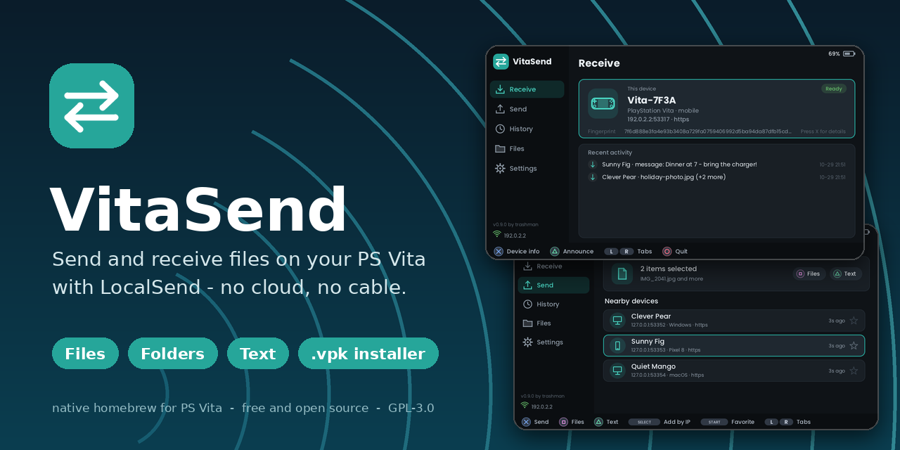
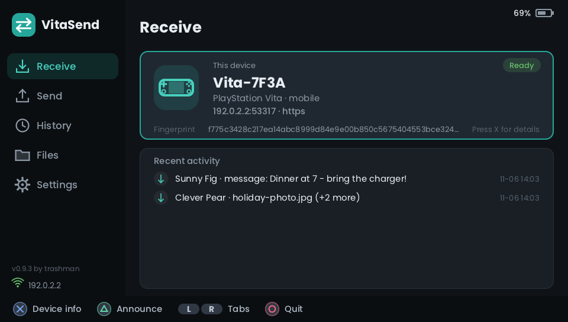
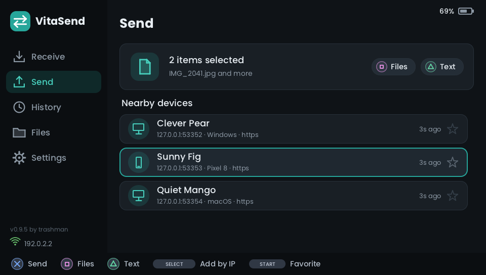
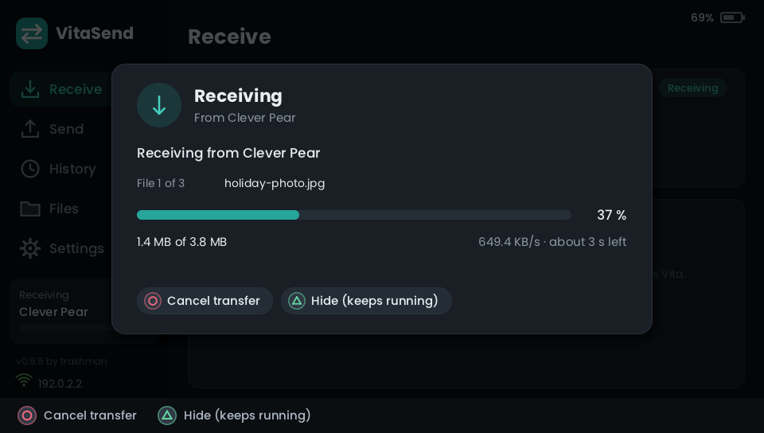
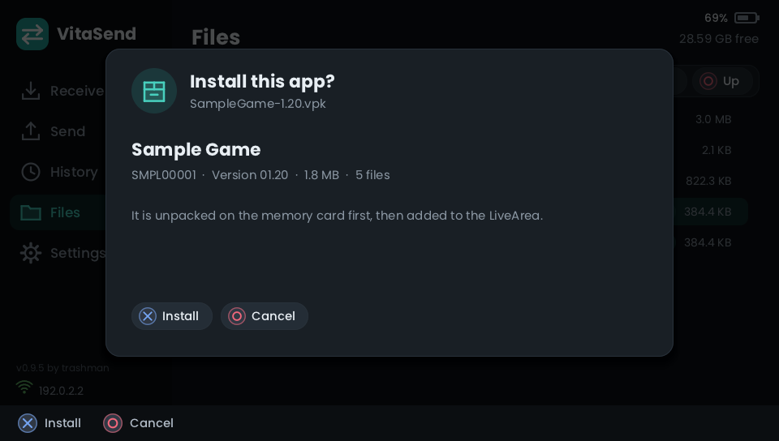

<p align="center">
  
</p>

# VitaSend

**Send and receive files, folders and text between your PS Vita and any device running [LocalSend](https://localsend.org) -
over your own Wi-Fi, no cloud, no cable.** A native homebrew app written in C, with a touch-friendly interface, a built-in
`.vpk` installer and a screensaver that shows your transfer progress.

[](https://github.com/Trashman1111/vitasend/actions/workflows/ci.yml)
[](https://github.com/Trashman1111/vitasend/releases)
[](LICENSE)

> VitaSend is an independent project. It speaks the open LocalSend protocol but is **not affiliated with** the LocalSend
> project or Sony. Status: **beta (v0.9.0)** - see [Status](#status).

<table>
  <tr>
    <td></td>
    <td></td>
  </tr>
  <tr>
    <td></td>
    <td></td>
  </tr>
</table>

More pictures are in [`docs/screens/`](docs/screens/) (OLED theme, settings, file browser, screensaver, ...). They are
rendered on a PC by the same drawing code the Vita runs.

## Features

* **Works with LocalSend** (protocol v2.1): the Vita shows up in the LocalSend apps on your network, and the Vita can find
  them. Send **files, whole folders and text** in both directions.
* **Made for a handheld**: the left menu, tabs, cards and PlayStation button hints; everything works with **buttons,
  D-pad and the front touch screen** (tap, drag to scroll). Dark and pure-black **OLED** theme. Accents, Greek and
  Cyrillic text.
* **Receive safely**: you accept or reject every request (or use *Quick Save* for favourites / everyone), optional **PIN**,
  free-space check, SHA-256 verification, existing files kept / skipped / overwritten as you choose.
* **Files tab**: browse your memory cards, tick several files and send them together, rename, delete, create folders.
* **`.vpk` installer** like VitaShell's: install a received package with one button, install a whole **queue**, or let
  VitaSend install packages from favourites automatically (off by default). *Open app* right after installing.
* **Screensaver** with the bouncing logo and live transfer / installation progress; wakes on touch, button, a request or
  a finished job. Optional **battery** indicator and **clock**, a short **finished chime**.
* **Retry** a failed transfer with only the files that did not arrive, **history** of the last transfers and messages,
  **favourites**, a **device details** page, an on-screen **log** for troubleshooting.
* **No dependencies** beyond mbedTLS: its own HTTP server and client, JSON, ZIP / DEFLATE reader and 2D renderer.

## Install

You need a PS Vita with custom firmware (HENkaku / ensō - see the [Vita Hacks Guide](https://vita.hacks.guide/)) and
[VitaShell](https://github.com/TheOfficialFloW/VitaShell).

1. Download **`VitaSend-v090.vpk`** from the [Releases](../../releases) page.
2. Copy it to your Vita (USB or FTP) and install it with VitaShell (open the file, press **X**).
3. In the HENkaku settings turn on **"Enable unsafe homebrew"** - the installer needs the extended permissions
   (see [why](docs/BUILDING.md#why-the-app-is-unsafe)). Without it the app will not start.
4. Start **VitaSend** from the LiveArea.

## Quick start

* **Vita to Vita / PC / phone:** connect both to the same Wi-Fi, open LocalSend on the other device, and send to the
  device named `Vita-XXXX`. The Vita shows who is sending - press **X** to accept.
* **From the Vita:** open the **Send** tab, press **SQUARE** to choose files (or **TRIANGLE** to type a text), pick the
  other device in the list and press **X**.
* **Install an app you received:** when the transfer finishes, press **TRIANGLE** to install it (or open the **Files** tab
  and press **SQUARE** on a `.vpk`).
* The Vita cannot see the other device? Some routers block multicast between Wi-Fi clients ("client isolation"). Turn that
  off, press **TRIANGLE** on the Receive tab to announce again, or use **SELECT > Add by IP** on the Send tab.

Everything else - controls, settings, the installer, troubleshooting - is in the **[user guide](docs/USER_GUIDE.md)**.

## Status

VitaSend is a **beta**. What has been checked:

* This is being used on a real PS Vita **PCH-1004** with the **LocalSend Windows, Linux and Android App**: receiving and sending files, text, installing
  packages, touch, screensaver, sound.
* About **520 automated checks** run on a PC against the real mbedTLS under AddressSanitizer / UBSan: the protocol
  (against stand-ins that play the other LocalSend device), the transfer engines, the `.vpk` installer (ZIP / DEFLATE
  compared with Python's `zlib`, corrupted and malicious packages), and the whole interface including simulated touch.
  See [docs/TESTING.md](docs/TESTING.md).
* **Not yet tested:** the LocalSend apps for iOS / macOS, other Vita models (PCH-100x vs PCH-200x, PS TV) and
  firmware versions, ensō-only setups. Reports are very welcome - use the *Bug report* template and attach the log
  (*Settings > Log*).

Known limits: one transfer at a time, one TLS connection per file (many tiny files are slow), the browser-download API and
IPv6 are not supported, only Latin / Greek / Cyrillic text can be displayed. Details in the
[user guide](docs/USER_GUIDE.md#limits-you-will-notice) and [PROTOCOL.md](docs/PROTOCOL.md).

## Build from source

```sh
export VITASDK=/usr/local/vitasdk && export PATH=$VITASDK/bin:$PATH
./scripts/build-mbedtls.sh            # once: downloads and builds mbedTLS 3.6.2 (checksum verified)
mkdir build && cd build && cmake .. && make -j4
```

The result is `build/VitaSend-v090.vpk`. Docker, WSL, CMake options and common problems: **[docs/BUILDING.md](docs/BUILDING.md)**.

You can also build the whole program as a normal Linux program and test it without a Vita:

```sh
./scripts/build-mbedtls.sh host && make -C host SAN=1
python3 host/fake_peer.py && python3 host/test_transfer.py
```

## For developers

The code is plain portable C. **Only two files talk to the Vita** (`src/plat_vita.c`, `src/ui_vita.c`); everything else
runs unchanged on a PC, which is how it is tested. Start here:

| Document | What is in it |
|---|---|
| [docs/ARCHITECTURE.md](docs/ARCHITECTURE.md) | layers, threads, source map, how receiving / sending / installing / the UI work |
| [docs/ABOUT_THE_PORT.md](docs/ABOUT_THE_PORT.md) | how the port works, the tools used, and the Vita-specific problems and decisions |
| [docs/PROTOCOL.md](docs/PROTOCOL.md) | which parts of the LocalSend protocol are implemented, and how |
| [docs/BUILDING.md](docs/BUILDING.md) | building the VPK and the PC test build |
| [docs/TESTING.md](docs/TESTING.md) | the test harness, test knobs, regenerating the screenshots |
| [CONTRIBUTING.md](CONTRIBUTING.md) | how to send a change |

```
src/        the program (see docs/ARCHITECTURE.md for a map of every file)
host/       PC build + the test scripts
scripts/    build-mbedtls.sh
tools/      generators for the icons / LiveArea images and the embedded fonts
sce_sys/    bubble icon and LiveArea images
fonts/      font licences (the fonts themselves are compiled into src/fontdata.c)
docs/       documentation and screenshots
```

## License and credits

VitaSend is free software under the **GNU General Public License v3.0 or later** ([LICENSE](LICENSE)). The whole project is
GPL because the installer follows [VitaShell](https://github.com/TheOfficialFloW/VitaShell) by TheFloW (GPL-3.0): the
`head.bin` template and the install procedure. Other components: mbedTLS (Apache-2.0 / GPL-2.0+), stb_truetype
(public domain), the Poppins and Liberation Sans fonts (SIL OFL 1.1) - details in
[THIRD_PARTY_NOTICES.md](THIRD_PARTY_NOTICES.md).

The [LocalSend](https://github.com/localsend/localsend) protocol is by Tien Do Nam and contributors. "PlayStation" and
"PS Vita" are trademarks of Sony Interactive Entertainment Inc.; this project is not affiliated with or endorsed by either
company.

Made by **trashman**. Developed with AI assistance. Found a bug or have an idea? [Open an issue](../../issues).
