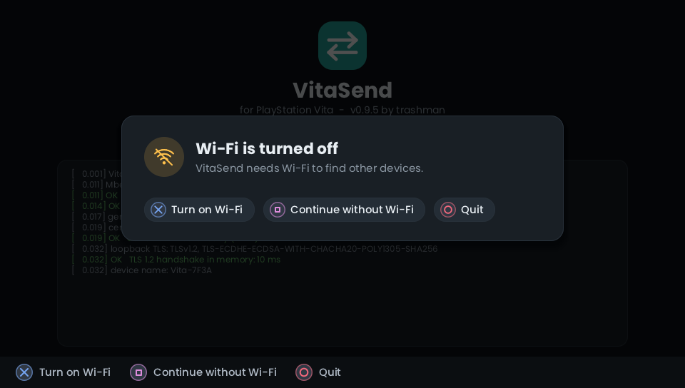
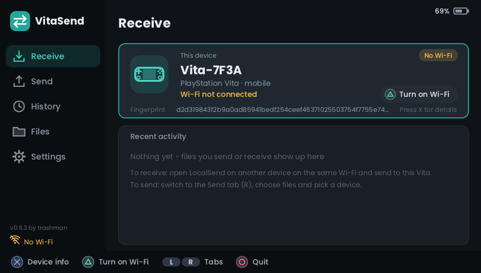

# VitaSend user guide

Everything about *using* the app. (Install and first steps: [README](../README.md). Building it: [BUILDING.md](BUILDING.md).)

Connect the Vita to the same Wi-Fi as your other device and start the app. The left side is a menu like the desktop
app's; switch between its five pages (Receive, Send, History, Files, Settings) with **L** and **R** - or just tap them. The D-pad can do it too: **LEFT** moves the focus to the tab list (an outline marks the current tab), **UP/DOWN** there change the page (wrapping around), **RIGHT**, **X** or **O** return to the page. Touching the screen also gives the focus back to the page.

### Touch screen

The **front touch screen** works next to the buttons (the back touch pad is ignored). Everything that shows a button
symbol can be tapped instead of pressed:

* **Left menu:** tap a page. Tap the little progress card to open a running transfer.
* **Lists** (Files, file browser, Send devices, History, Settings): tap a row - it is selected and opened/activated like **X**
  (a device on the Send page: sends; a file in the browser: ticks it, the tick circle also ticks folders). **Drag** up or
  down to scroll. In a folder, the **Up** button at the top right goes up one level.
* **Buttons in dialogs** (Accept / Reject / Install / Cancel / Close / Yes / No ...) and the **hint bar** at the bottom
  (every item with a button symbol) can be tapped. Tapping outside a dialog does nothing.
* **Send page:** tap the star on a device for favorite.
* **On-screen keyboard:** tap the keys and the alphabet tabs; Delete, Space, Done and Cancel are in the hint bar.
* **Message viewer:** drag to scroll long texts.

| Page / dialog | Buttons |
|---|---|
| **Receive** | shows this Vita (name, address, fingerprint) and the latest transfers. The page opens with the focus on the **tab list**; **RIGHT** moves onto the *This device* block, **X** there opens the **device details** (name, model, address and port, protocol, fingerprint, receive folder and free space, Quick Save / PIN / install settings, app version and title ID - the address and fingerprint stay hidden when *Hide IP address and fingerprint* is on) - **TRIANGLE** announce again - **START** open a running transfer - **O** quit (asks first) |
| **Send** | the card on top says what will be sent; below are the devices found. **SQUARE** choose files or folders - **TRIANGLE** write a text message - **X** send it to the highlighted device - **START** favorite on/off (while no transfer is running; the star can always be tapped; favorites are listed first) - **SELECT** add a device by IP address (when automatic discovery is blocked) - **O** back |
| **File browser** | **X** open a folder / tick a file - **SQUARE** tick a file *or a whole folder* - **O** up / back - **TRIANGLE** done (if nothing is ticked, the file under the cursor is used) - **L/R** page up/down |
| **History** | **X** read a text message in full - **O** back |
| **Files** | browse the memory card(s), starting in the folder for received files; the top line shows the free space. **X** is the main button: it opens a folder, **installs a .vpk** (asks first), **unzips a .zip file** (asks first; see below), or **opens a picture or text file** in the viewer (see below) - **SQUARE** ticks / unticks the highlighted entry (a file *or* a whole folder; the circle on the left of every row ticks it too) - **TRIANGLE** sends the ticked entries (or the highlighted one if nothing is ticked) - **SELECT** options menu (tick everything, untick everything, **copy**, **move**, **rename**, **delete**, **new folder** - what already has its own button is not repeated there) - **O** up. With **several entries ticked**, **X** opens them as a queue: pictures and text files in the viewer (you can page through them), packages in one "Install these apps?" question. Ticked folders and files that cannot be opened are left out (a message says so); packages and pictures cannot be mixed in one queue. Deleting always asks first, then shows a progress bar (files and folders counted; **O** stops, what is gone stays gone); a folder is deleted with everything in it; VitaSend's own data folder cannot be deleted. **Copy / move:** choose *Copy* or *Move* in the menu (it takes the ticked entries, or the highlighted one), open the destination folder and press **TRIANGLE** (or tap **Copy here** / **Move here**); *Cancel the copy / move* is in the menu too. A move inside one memory card is instant. Between two cards (or for a copy) the data is copied in the background with a progress dialog (**O** cancels); a move removes the original only after its copy is complete. Nothing is overwritten: a copy to a name that exists becomes `name (1).ext`, a move skips it and tells you. A folder cannot be copied or moved into itself. |
| **Viewer** (pictures and text files) | **JPEG, PNG, BMP and GIF** pictures are shown whole, scaled to the screen (at most 2x bigger), turned the right way up if the photo says so. **Text files** (`txt md log json xml ini cfg conf csv lua c h py js html yml toml sh srt ...`) are shown wrapped; the first 128 KB are read. **L / R** or **LEFT / RIGHT** (or a tap on the left / right third of the screen) go to the previous / next file of the queue; in a text, **UP / DOWN** scroll a line and **LEFT / RIGHT** a page (drag to scroll, too). **O** closes and returns to the Files tab with the ticks kept. Very big pictures are refused with a message (more than 10 megapixels, a progressive JPEG over 2.5, other formats over 6) so that the Vita does not run out of memory. The screensaver does not start while the viewer is open. |
| **Unzip** | **X** on a `.zip` (or *Unzip ...* in the SELECT menu) asks *Unzip this file?* - it shows the number of files, the unpacked size and the name of the **new folder** (next to the zip, named like it; a taken name gets `(1)`). **X** unpacks with a progress bar, **O** cancels and removes the new folder again; afterwards **X** shows the folder. Only stored and deflate-compressed zip files work (no passwords, no ZIP64); a zip with names that would escape the folder (`..`, absolute paths) is refused before anything is written, and a damaged file inside or a full card leaves nothing behind. The zip itself stays. |
| **Several packages** | one question lists them all (names, versions, which ask for extended permissions, which cannot be installed and are left out). **X** install all - **O** cancel. They are installed one after another ("Installing 2 of 3"); a package that fails does not stop the others; **O** while unpacking cancels the current one *and the rest*. A summary at the end shows what happened to each. Reach it with **TRIANGLE** on the result of a transfer that brought several .vpk files, or tick packages in the Files tab (**SQUARE**) and press **X** (up to 16 at once). The question is titled *Install these apps?*. |
| **Install question** (for a .vpk) | shows the app's name, title ID, version, size and whether it asks for extended permissions. **X** install - **O** cancel. Then a progress screen: **O** cancels while unpacking. |
| **Settings** | **X** change - **SQUARE** (on the PIN line) remove the PIN - **O** back. Rows are grouped under headers. **This device:** device name, PIN, **Hide IP address and fingerprint** (X switches it; hides this Vita's address in the left menu and on the Receive page, handy for screenshots - the log and other devices' addresses are not affected). **Receiving:** folder for received files, **Quick Save**, **Install received .vpk files** (X opens a dropdown; choosing another value shows what it does and what it risks, **X** = yes, **O** = no), **When a received file already exists** (dropdown: *Keep both* / *Skip* / *Overwrite*). **Display and sound:** **Colours** (*Dark* / *OLED*), **Battery indicator** (percentage and symbol at the top right, on by default), **Clock** (HH:MM in the same size and font, left of the battery, off by default), **Screensaver** (dropdown: *Off* / 30 s / 1 min / 2 min / 5 min), **Sound** (the finished chime, on by default), **Check for updates at start** (On by default, X switches it). Rule for all settings: with more than two options you choose from a dropdown list (only the risky ones ask for confirmation); with two options X switches. **About:** a box with the version, the version date and the credit and a **Check for updates** button, then the log and quit. |
| **Incoming request** (pops up on its own) | **X** accept - **SQUARE** accept and make the sender a favorite - **O** reject |
| **Transfer** | **O** cancel (asks first) - **TRIANGLE** hide it, it keeps running - **X** close when finished - **TRIANGLE** when finished and a **.vpk** arrived: install it. While one runs, the left menu shows a small progress card. |
| **On-screen keyboard** | D-pad move - **X** type - **SQUARE** delete - **TRIANGLE** space - **L/R** switch alphabet (ABC, accented letters, Cyrillic, Greek) - **START** done - **O** cancel |

**Quick Save** is what the desktop app calls it: *Off* asks every time, *Favorites* accepts from favorites and asks
everyone else, *Everyone* accepts everything.

**Sending to a Vita:** pick the Vita in the other app and send. A dialog shows who is sending, how many files and how
big. Files are written as `name.part` and renamed when complete, existing files are kept by default (`name (1).ext`; Settings can instead *skip* files that are already there - if all of them are, the sender is told there is nothing to send - or *overwrite* them; the request dialog warns when files would be overwritten),
and the SHA-256 is checked when the sender provides one.

**Automatic installation (off by default):** *Settings > Install received .vpk files*. With *Favorites only* a .vpk that arrives from a favorite is installed as soon as it is complete, with *Everyone* any received .vpk is. A package can run anything on your Vita and the sender's name is only what it announces, so keep this Off unless you trust everyone on your network. Broken packages are never installed automatically, and VitaSend never replaces itself. The install screen is still shown (with a note) and can be cancelled while unpacking.

**Screensaver:** after the chosen time without a button or touch the screen turns black and the VitaSend name and logo drift around it in straight lines, bouncing off the edges, slowly, together with the progress of a running transfer (or installation). Receiving carries on while it is showing. It ends when you press a button or touch the screen (that press or touch does nothing else - nothing is pressed by accident), when a request or message arrives, or when the whole job is over: a download, or - when *Install received .vpk files* installs it by itself - the installation after it. The idle timer then starts again, once; if you leave the "Installed" screen alone, the screensaver comes back. The default is 30 seconds; *Settings > Screensaver* changes it or switches it off. It does not start while a request waits for your answer or while you type.

**Open the installed app:** on the "Installed" screen **SQUARE** starts the app that was just installed (after a queue: when exactly one package was installed). It needs the SceAppMgr stub library of your VitaSDK (every normal SDK has it; without it the button is not offered).

**Sound:** a short two-note chime plays when a download has finished, and when an installation has finished (a single package, or the end of a whole queue) - nothing in between. If *Install received .vpk files* is on and installs the package by itself, the download chime is skipped and only the end of the installation chimes; if nothing gets installed after all, the download chime plays at once. *Settings > Sound* switches it off; switching it on plays it once as a preview. The chime is made by the program itself (no sound file) and follows the Vita's volume.

**Retry:** if a send fails, is cancelled or is refused, the result dialog shows **Retry (N files left)** - **TRIANGLE** sends only the files that did not arrive to the same device (a half-sent file starts again from its beginning). A text message can be retried too.

**Text messages** from the other app appear on a message screen and are kept in the history. On the Send tab,
**TRIANGLE** types a message; then pick a device and press **X** - the other device sees it like any LocalSend text.

**PIN:** with a PIN set, senders must enter it. Five wrong attempts block everyone for a minute. When *you* send
to a device that wants a PIN, the Vita asks for it.

### Updating VitaSend

A few seconds after start (once Wi-Fi is there) VitaSend asks GitHub for the newest release - **pre-releases count too**. If it is newer than the running version, a window offers it: **X = Download and install**, **O = Not now**. This question comes **at most once a day** and never while something else is going on (a transfer, a request, an installation, a dialog, the screensaver). Nothing is shown when you are up to date or when GitHub cannot be reached. Switch the automatic check off in **Settings > Check for updates at start**; look for an update yourself any time in **Settings > About > Check for updates**.

The download is checked against the SHA-256 the release publishes (`SHA256SUMS.txt`, or the digest GitHub shows for the file) and a release without a checksum is refused. The connection checks GitHub's certificate against root certificates built into the program. Then the installer shows *Install the new VitaSend?* (**X** = yes). VitaSend unpacks the new version and closes by itself; a small helper (an extra "VitaSend" bubble, title id `LSNDUPD01`) installs it and starts VitaSend again - the screen goes dark for a moment and nothing needs to be pressed. The helper is removed at the next start. (The system cannot replace an app while it runs, which is why the helper is needed.) Your settings and received files stay. The downloaded package is also kept in `ux0:data/VitaSend/update/`; if installing from inside the app does not work, install that file with VitaShell.

*Limits:* the Vita has no clock the TLS code can use, so certificate **dates** are not checked; and the update needs the internet, not only the local network.

### Installing .vpk packages

Two ways: receive a `.vpk` (when the transfer is finished the result screen offers **TRIANGLE = Install**), or open
the **Files** tab, go to the file and press **X** (or tick several with **SQUARE** and press **X**). The installer does what VitaShell does:

1. looks inside the package and shows what it is (name, title ID, version, size, "extended permissions?");
2. unpacks it to `ux0:data/pkg` (own ZIP/deflate code - no extra libraries; CRC-checked; names with `..` are refused;
   needs the unpacked size + 4 MB free);
3. writes `sce_sys/package/head.bin` (unless the package has its own) and hands the folder to the system installer,
   which adds the bubble to the LiveArea;
4. deletes the scratch folder (also after a failure or cancel).

**Things to know**

* The installer needs **extended permissions**: the app is built with `vita_create_self(... UNSAFE)` (CMake option
  `LS_UNSAFE`, on by default), exactly like VitaShell. Your Vita therefore needs **"Enable unsafe homebrew"** in the
  HENkaku settings, or the app will not start at all (the system then says it is an unsafe application). If you do
  not want that, build with `-DLS_UNSAFE=OFF`: everything works except the actual installation step, which then says
  "Cannot load the system module PAF - is the app installed as unsafe?".
* Only install packages from sources you trust: an app with extended permissions can do anything to your Vita
  (the question dialog warns about it, like VitaShell). Packages for *this* app (title `LSND00001`) are refused: it
  cannot replace itself while it is running - use VitaShell for that.
* While a package installs, incoming transfers are answered with "busy", and sending is not possible.
* Installing is only possible with enough free space for the unpacked package; the scratch folder is always removed.
* Games that need a licence, `.pkg` files and PSM content are not handled - this is for homebrew `.vpk` files.
* The installer code is derived from VitaShell (GPL-3.0, TheFloW): see [Licence](#licence--credits).

### Files on the memory card (`ux0:data/VitaSend/`)

(Early test builds used `ux0:data/LocalSendVita/`; on the first start that folder is renamed, so settings, certificate, history and received files come along.)

| File | What |
|---|---|
| `config.json` | `checkUpdates` (true/false: ask GitHub at start), `updateAskedDay` (the day, as YYYYMMDD, the update question was last shown), `alias`, `port`, `receiveDir`, `autoAccept` (0 ask, 1 favorites, 2 everyone), `hideIds` (true/false), `wifiSettingsUri` (optional: the system page the *Wi-Fi settings* button opens, default `settings_dlg:wifi`), `theme` (0 dark, 1 OLED), `pin` (digits, up to 8), `favorites` (list of `{fingerprint, alias}`). Written by the settings screen; you can edit it with the app closed. |
| `history.json` | the last 40 transfers and text messages |
| `received/` | default folder for received files |
| `cert.der`, `key.der` | device certificate + key (ECDSA P-256, self-signed). Delete both to get a new fingerprint |
| `log.txt` | what the on-screen log said |

## Limits you will notice

* One transfer at a time (a second sender gets "busy").
* A new TLS connection is opened for every file, so many tiny files are slow. The Vita's CPU is also slow at TLS
  (the app sets it to 444 MHz): expect a few MB/s at best.
* Text is drawn with Poppins and Liberation Sans: Latin (all European accents), Greek and Cyrillic work, also on the
  keyboard. Other scripts (Chinese, Japanese, Korean, Arabic, Hebrew, Thai, emoji) are shown as `?`; file names in
  any script are still received and sent correctly (UTF-8).
* "Accept automatically from favorites" trusts the name/fingerprint a sender *announces*; with HTTPS this cannot be
  verified. On a network you do not trust, keep it on *Ask*.
* History times are UTC and show `--:--` if the Vita's clock is unavailable.
* Before accepting files the Vita checks that they fit on the card (with 1 MB spare); if not, the sender gets `507` and the Vita shows why. If the Vita cannot read the free space, the check is skipped.
* At most 64 items can be ticked at once (folders count as one), receiving accepts up to 256 files per request.

## Troubleshooting

* **Installer: `Cannot load the system module PAF` / `Cannot load ScePromoterUtil`** - the app is not running with
  extended permissions. Install the VPK built with `LS_UNSAFE=ON` (default) and enable *unsafe homebrew* in HENkaku.
  **`The system refused the package (0x...)`** - the code is the system installer's own error; the usual causes are a
  package that is damaged or not a Vita app, not enough space, or a title ID clash with a protected app. The log
  (*Settings > Log*) has the same text. 
* **App crashes right at start** - build with `-DHELLO_ONLY=ON` to see whether it is the TLS self-test or the network
  part. The CDRAM framebuffers are in `src/ui_vita.c` (`ui_init`).
* **If the interface is slow** (laggy buttons) - the picture is drawn by the CPU. A normal screen should take well
  under 50 ms; dialogs are cached. If it feels sluggish, open an issue and say which screen; the usual remedy is drawing less per frame
  (the places are `ui_draw_chrome` and `gfx_clear`). The CPU is already set to 444 MHz by the app.
* **`Server not running: ...` / `FAIL TCP port 53317: ...` / `UDP port 53317 unavailable`** - the Vita refused to open
  its network port. The text is the raw error report of the Vita's network library: the stage (`socket`, `bind`,
  `listen`), the error code of each way the app tried (`80410130` = address in use, `80410116` = invalid argument,
  `8041010D` = permission denied, `80410137` = out of network memory) and `p0=ok/fails` (whether the system can give
  out *any* free port). It is also in `log.txt`. The app tries several ways of opening the port, then the next 9 ports
  (53318, ...), then any free port the system offers; other devices learn the port from the announcement. A copy of this
  app that was not closed properly can keep the port for a while: close the app completely (hold the PS button, close
  it) or restart the Vita once.
* **Wi-Fi is turned off** - at the start VitaSend asks; **SQUARE** (*Continue without Wi-Fi*) starts the app offline, for example to
  use the Files tab - it connects by itself when Wi-Fi comes later. **X** (or tapping *Turn on Wi-Fi*) tries to switch Wi-Fi on itself.
  Sony gives apps no official way to do that, so VitaSend uses an undocumented system call that **does not exist on every
  firmware** (it is missing on retail firmware, for example). Then the dialog says *Wi-Fi could not be turned on* and offers
  **TRIANGLE = Wi-Fi settings**: it opens the Vita's own settings (VitaSend closes while you use them - start it again
  afterwards; if the settings cannot be opened from the app, the dialog says so and you use *Settings > Network* yourself).
  While the dialog is open VitaSend keeps waiting and carries on by itself as soon as Wi-Fi is there. If Wi-Fi drops while the app
  runs, the Receive page shows **No Wi-Fi** with a **Turn on Wi-Fi** button (**Wi-Fi settings** once switching on has failed;
  TRIANGLE, or tap the *No Wi-Fi* row at the bottom of the left menu). `log.txt` has the lines `Wi-Fi: sceWlanSetConfiguration(1)
  returned 0x...` or `this firmware has no such call`, and `Wi-Fi: launching ... returned 0x...` for the settings. The page that opens is `settings_dlg:wifi`; to try another one add `"wifiSettingsUri": "settings_dlg:..."` to `config.json` (with the app closed).

   
* **The Vita doesn't appear on the other device (or the other way round)** - some routers block multicast between
  Wi-Fi clients ("AP isolation" / "client isolation"); turn that off. Press TRIANGLE on the Vita to announce again.
  The log says `found ...` for every device it hears and `registered with ...` when the handshake worked.
  If multicast is blocked, the other device may still find the Vita by scanning the network, and the Vita lists any
  device that registers with it.
* **A transfer fails** - the transfer screen says why in plain words (`the other device said no`, `could not connect`, ...).
  *Settings > Log* shows the on-screen log, and `log.txt` has the same.
* **Nothing arrives in the folder you expect** - check *Save received files in* in the settings; the default is `ux0:data/VitaSend/received`.
